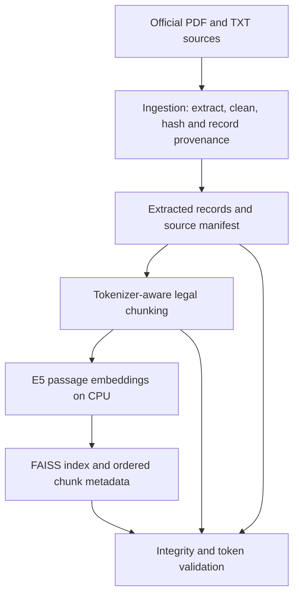
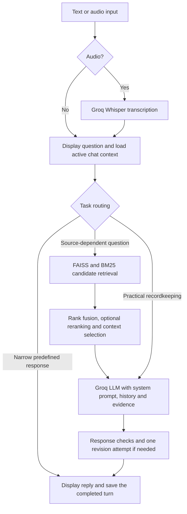

# Kuku AI Legal & Citizen Assistance

## Quick start (Windows PowerShell)

Drive link for demo and summary pdf = https://drive.google.com/drive/folders/11xJvgVJiDQ5JFb7Ho7uH1OqThtTQAMTi?usp=sharing

Run these commands from the project root. Python 3.11 is recommended. Install dependencies if this is a fresh clone:

```powershell
py -3.11 -m venv .venv
.\.venv\Scripts\python.exe -m pip install -r requirements.txt
```

Create a private `.env` file from the provided template:

```powershell
Copy-Item .env.example .env
notepad .env
```

In the opened file, set `GROQ_API_KEY` to **your own Groq API key**, and save it. `LLM_MODEL=openai/gpt-oss-120b` in the template is the model served through Groq; use an ID your Groq account can access. Do not put a real key in `.env.example` or commit `.env` to GitHub.

start the app:

```powershell
.\.venv\Scripts\python.exe -m streamlit run app.py
```

Open the local URL shown in the terminal. If the index is missing or you change documents, follow [Installation and execution](#installation-and-execution) to rebuild and validate it. Read the [project summary](kuku_project_summary.pdf) for a short overview.

A conversational **retrieval-augmented generation (RAG)** application that helps people understand everyday Indian citizen issues using a curated collection of Acts, government guides and FAQs.

Built under Kuku, the authority conducting this project, this application combines **Streamlit**, **Groq-hosted language and speech models**, and local **multilingual embeddings, FAISS, BM25 and cross-encoder reranking**. It supports text, voice, source references and persistent conversations.

> This assistant provides legal information and practical assistance. It is not a substitute for a qualified lawyer. Its document-integrity checks do not establish legal accuracy, current applicability or completeness of coverage.

## Contents

- [Why this project?](#why-this-project)
- [Features and scope](#features-and-scope)
- [Architecture](#architecture)
- [Models and technology](#models-and-technology)
- [Dataset and sources](#dataset-and-sources)
- [Project structure](#project-structure)
- [Code reference](#code-reference)
- [Installation and execution](#installation-and-execution)
- [Configuration](#configuration)
- [Rebuilding and generated files](#rebuilding-and-generated-files)
- [Validation and testing](#validation-and-testing)
- [Troubleshooting](#troubleshooting)
- [Data handling and limitations](#data-handling-and-limitations)
- [Future improvements](#future-improvements)

## Why this project?

People dealing with unpaid salary, rental deposits, consumer disputes or banking complaints often need an understandable first step. Relevant information is spread across long legal documents, unfamiliar terminology and multiple government websites.

This assistant makes a selected document collection searchable through conversation. The goal is to provide short, useful replies, retain relevant facts within a chat, and help with practical tasks such as drafting a message or organizing records.

### Why RAG?

The project uses pretrained models rather than training or fine-tuning a language model. RAG allows the application to retrieve relevant source material at answer time and attach references to generated legal explanations. Updating the collection involves reprocessing documents and rebuilding the index rather than retraining the language model.

Retrieval supplies evidence; it does not guarantee that a generated interpretation is correct.

## Features and scope

- **Conversational replies:** short answers by default, with longer drafts or checklists when requested.
- **English, Hindi and Hinglish:** language-aware prompting and multilingual retrieval.
- **Text and voice:** microphone recording and uploaded audio transcription.
- **Immediate input display:** the question or transcript appears before answer processing completes.
- **Persistent chat history:** create, reopen and delete separate chats in the sidebar.
- **Contextual follow-ups:** use recent conversation to interpret references, corrections and recordkeeping questions.
- **Practical assistance:** draft or revise an email/WhatsApp message, or combine a draft with a checklist.
- **Source references:** citation labels and supporting-source details for cited responses.
- **Hybrid retrieval:** semantic and keyword search, rank fusion and optional reranking.
- **Pipeline checks:** source hashes, extraction manifests, tokenizer checks and index/metadata alignment.

### Intended topic coverage

| Topic | Example requests |
| --- | --- |
| Employment | Unpaid salary, employment records, messages to HR |
| Housing and tenancy | Rental deposits, tenancy documents, landlord messages |
| Consumer issues | Refunds, defective products, complaint information |
| Banking and payments | Banking disputes, payment problems, ombudsman guidance |
| Cyber issues | Cybercrime reporting and cyber-safety information |
| Citizen protection | Free legal aid, family matters, women and child protection |
| Other corpus-supported rights | Education, disability and senior-citizen questions |

Coverage depends on the available documents, their jurisdiction and the retrieved passages. The presence of a topic in this table is not a guarantee that every question about it can be answered.

## Architecture

### 1. Offline knowledge-base preparation



1. **Ingest:** read PDFs and TXT/FAQ files recursively from `data/raw/`.
2. **Preserve provenance:** retain document identifiers, filenames, physical page references and FAQ locators.
3. **Chunk:** split text using the embedding tokenizer, preserving useful section and document context.
4. **Embed:** encode passages as normalized 384-dimensional vectors.
5. **Index:** save the FAISS index, aligned metadata and checksummed manifest.
6. **Validate:** compare the source inventory, extracted records, chunks and stored vectors.

### 2. Online question answering



#### Retrieval details

- **Semantic search:** encode the contextual query with E5 and search FAISS.
- **Keyword search:** BM25 captures explicit terms, section numbers and lexical matches.
- **Query expansion:** supplement the query while retaining its original terms.
- **Reciprocal-rank fusion (RRF):** combine semantic and lexical result rankings.
- **Reranking:** score up to 24 fused candidates with the cross-encoder when enabled.
- **Context selection:** pass up to 6 selected passages to generation.

The FAISS index uses exact inner-product search over normalized vectors, giving cosine-similarity ranking. BM25 is constructed from loaded metadata; it is not a separate external search service.

#### Prompting and response checks

`SYSTEM_PROMPT` lives in **`src/assistant_service.py`**. The service combines it with per-turn language and formatting instructions. Recent history is supplied as context, while retrieved passages are supplied as evidence.

The prompt asks for concise replies, appropriate follow-up questions, the requested draft format and citations for specific legal claims. A request such as “give me only the email” should suppress an additional conversational question.

The response pipeline checks citation identifiers, malformed markers, selected uncited claims, some deadline mismatches, language/script and unwanted draft formats. It allows one revision attempt before using a suitable fallback or reporting insufficient support.

**These are heuristic checks, not full claim-to-source entailment verification.** Practical recordkeeping can bypass retrieval; a narrow unpaid-salary first-step request also has a predefined reply. Therefore, not every response is an LLM-generated, cited answer.

## Models and technology

| Component | Model / technology | Role |
| --- | --- | --- |
| Answer generation | `openai/gpt-oss-120b` via Groq | Generate conversational answers and drafts |
| Speech-to-text | `whisper-large-v3-turbo` via Groq | Transcribe recorded or uploaded audio |
| Embeddings | `intfloat/multilingual-e5-small` | Encode queries and passages locally on CPU |
| Reranker | `cross-encoder/mmarco-mMiniLMv2-L12-H384-v1` | Reorder retrieved candidates by query relevance |
| Vector search | `faiss-cpu` | Search normalized passage vectors |
| Keyword search | `rank-bm25` | Lexical candidate retrieval |
| Interface | Streamlit | Chat, audio controls, sources and sidebar history |
| PDF extraction | PyMuPDF | Extract text with physical page provenance |
| State storage | SQLite and JSON serialization | Persist separate conversations |
| Model runtime | SentenceTransformers, Transformers, PyTorch | Local embedding and reranking inference |
| Configuration | `python-dotenv` and validated dataclass settings | Load environment configuration |

Qwen was explored during development; the documented working configuration uses GPT-OSS through Groq. The `openai/` prefix identifies the model, while **Groq is the API provider used by this code**.

No GPU is required by the current CPU-based local pipeline. Initial model downloads and CPU inference can make the first build or first question slower.

## Dataset and sources

The collection contains Acts, government manuals, citizen guides and FAQ text. It was organized into `data/raw/acts/` and `data/raw/guides/`, with unreadable or unwanted inputs reviewed and removed.

| Official source | Material represented |
| --- | --- |
| [India Code](https://www.indiacode.nic.in/) | Acts and codes covering selected civil, consumer, employment and protection topics |
| [NALSA FAQs](https://nalsa.gov.in/faqs/) | Legal-services and legal-aid FAQ material; the saved text records this source URL |
| [NCPCR](https://ncpcr.gov.in/) | Child-protection, school bullying and cyberbullying guidance |
| [Reserve Bank of India](https://www.rbi.org.in/) | Banking grievance and ombudsman FAQ material |
| [National Cyber Crime Reporting Portal](https://cybercrime.gov.in/) | Citizen reporting/user-guide material |

Other inventory entries include consumer-protection FAQs, cyber-safety guidance and `FAQPMKISAN.pdf`. Exact original download URLs were not retained for every local document; the portal list is not a per-file provenance manifest.

### Preparation and quality controls

- PDF text is extracted page by page; FAQ text is separated into question/answer records.
- Cleaning preserves legal punctuation, numbering, paragraphs and meaningful Unicode characters.
- SHA-256 checksums support duplicate detection and stale-file checks.
- Optional `data/document_metadata.json` can supply reviewed metadata keyed by paths relative to `data/raw/`.
- Consecutive PDF pages can be joined during chunking while retaining page mappings.
- Section-heading heuristics improve context for Acts; FAQ records remain independent.
- The embedding tokenizer checks the full input, including headers, E5 prefixes and special tokens.
- Failed files, empty sources or failed pages block default ingestion publication.
- OCR is not implemented; scanned documents may require OCR outside this pipeline or readable replacements.

### Last recorded successful build

These counts describe the validated development corpus, not a fixed requirement for other datasets.

| Metric | Result |
| --- | ---: |
| Unique source documents | 58 |
| Extracted records | 3,079 |
| PDF-page records | 2,992 |
| FAQ records | 86 |
| Other TXT records | 1 |
| Indexed chunks / FAISS vectors | 11,335 |
| Embedding dimensions | 384 |
| PDF chunks with valid page references | 11,240 |
| File errors / empty sources / failed pages | 0 / 0 / 0 |
| Extraction warnings | 67 across 8 sources |
| Manually unverified titles | 58 |

The earlier 11,493-chunk build used different segmentation. A change in chunk count can be expected after changing chunking logic or source data.

## Project structure

```text
kuku/
    app.py
    config.py
    requirements.txt
    README.md
    kuku_project_summary.pdf     # Project overview (PDF)
    .env.example
    .env                         # Local secret configuration; do not commit
    .gitignore
    .streamlit/
        config.toml
    src/
        __init__.py
        assistant_service.py
        models.py
        ingestion.py
        chunking.py
        embeddings.py
        retriever.py
        groq_client.py
        safety.py
        utils.py
    scripts/
        01_ingest.py
        02_build_index.py
        03_check_data.py
    data/
        raw/
            acts/
            guides/
        document_metadata.json   # Optional reviewed metadata
        manifest.json            # Generated by ingestion
    processed/                   # Generated extraction, chunks and reports
    vector_store/                # Generated index, metadata and embedding cache
    .venv/                       # Local Python environment; do not commit
```

Chat history is stored separately at `~/.kuku/chats.sqlite3`, rather than inside the repository. On Windows, this is under the current user's home directory.

## Code reference

### Application and configuration

| File | Responsibility and important entry points |
| --- | --- |
| `app.py` | Streamlit entry point. Renders chat messages, input controls, transcripts, processing feedback and supporting sources. `process_text()` handles a completed turn without committing partially failed state. `_service_resource()` caches the assistant and coordinates shared access; `_index_version()` tracks index changes. `_history_connection()`, `_save_active_chat()`, `_switch_chat()` and `_delete_chat()` manage SQLite history. `display_sources()` formats source details. |
| `config.py` | Defines immutable `Settings` and the shared `settings` instance. Loads `.env` without overriding existing environment variables. Validates strings, booleans, numbers, token budgets and retrieval settings. Exposes project paths and `require_groq_key()`. It defines settings, not the system prompt. |
| `requirements.txt` | Dependency version ranges for the interface, APIs, extraction, embeddings and retrieval. These ranges are not a fully pinned reproducible lockfile. |
| `.env.example` | Shareable configuration template with an empty API key. Copy it to `.env` for local use. |
| `.env` | Private API key and local overrides. Never commit real credentials. |
| `.streamlit/config.toml` | Streamlit server/UI settings. Set the server upload limit here for versions whose uploader uses a server-wide limit. |
| `.gitignore` | Repository exclusions for secrets, environments, caches and generated/private data. Review it before publishing. |
| `README.md` | Setup instructions, architecture, module reference and operational notes. |

### Conversation and API modules

#### `src/assistant_service.py`

The orchestration layer connecting the UI, conversation state, retrieval and generation.

- `AssistantService.handle_text()` validates input and coordinates routing, retrieval, generation and state updates.
- `transcribe()` forwards audio to the speech API wrapper.
- `_case_context()`, `_recent_history()` and `_retrieval_query()` use recent conversation to interpret follow-ups.
- `_draft_requested()` distinguishes requests for a draft/revision from ordinary questions.
- `_records_only()` routes practical recordkeeping requests without treating every checklist as a legal claim.
- `_select_evidence()` and the evidence/source formatters prepare passages and display metadata.
- `_generate_answer()` builds model messages, applies response checks and requests a revision when needed.
- `_records_fallback()` and `_rental_deposit_first_step()` provide limited practical fallbacks.
- `TurnResult` packages the reply and associated output; `MAX_QUERY_CHARS` currently limits input to 6,000 characters.
- **`SYSTEM_PROMPT` is the main place to edit the assistant's role and response behavior.**

#### `src/models.py`

Defines `CaseState`: messages, scenario, collected facts, missing facts, workflow status and UTC timestamps.

`add_message()`, `update_fact()` and `set_scenario()` update state. `prior_messages()` avoids duplicating the current question in history. `to_dict()` and `from_dict()` support validated, detached serialization. The presence of structured fact fields does not imply a separate comprehensive fact-extraction model.

#### `src/groq_client.py`

Wraps Groq chat and transcription behind `GroqClient.chat()` and `GroqClient.transcribe()`. Validates request settings, applies configured timeout/retry limits and checks audio inputs. `close()` releases the client. `MAX_AUDIO_BYTES` defines the application audio-size cap.

#### `src/safety.py`

Provides urgent-pattern screening, concise notices, citation parsing/auditing and source labels. Important helpers include `urgent_flags()`, `safety_notice()`, `extract_citations()`, `validate_citations()`, `citation_audit()`, `has_unmatched_cited_deadline()`, `source_label()` and `evidence_warning()`.

Citation identity and formatting checks do not establish that the source supports a claim. Urgent-pattern detection is screening, not professional triage.

### Knowledge-base and retrieval modules

#### `src/ingestion.py`

`ingest()` walks the raw collection and coordinates extraction and publication. `extract_pdf()` retains physical page numbers and records individual page failures. `extract_txt()` handles FAQ/text blocks without silently discarding malformed sections. `make_record()` creates records with stable identifiers and provenance.

The module loads optional metadata overrides, detects duplicate files, produces reports and prevents normal publication when extraction is incomplete. Candidate titles are not treated as verified legal metadata.

#### `src/chunking.py`

`build_chunks()` creates retrieval passages from extracted records. `chunk_record()` supports individual PDF/FAQ/TXT records. Tokenizer helpers count actual embedding tokens; section and page helpers retain structure and source mapping.

It joins only consecutive PDF pages, prefers useful text boundaries, adds compact context headers and fits overlap within the token budget. The configured target is 380 tokens with 60-token overlap, subject to the full embedding-input limit.

#### `src/embeddings.py`

`encode_texts()` produces normalized vectors using the local embedding model. `build_faiss_index()` validates chunks, adds the `passage:` prefix, caches completed embedding batches and writes index artifacts. Query inputs use `query:`.

`load_faiss_index()` checks index type, model, dimensions, counts, checksums and ordered metadata. Build locks, staging and backup/replacement logic reduce inconsistent publication during ordinary failures. The implementation should not be described as a fully transactional multi-file database.

#### `src/retriever.py`

`Retriever` loads the index and metadata, constructs BM25 and exposes `search()`. Its internal search, fusion and reranking methods combine semantic and lexical candidates, apply compatibility logic and return `RetrievedChunk` objects with citation identifiers.

The `ready` property reports retrieval availability. Reranker loading is cached. Jurisdiction-related metadata and query handling help relevance but cannot determine every legal applicability question.

#### `src/utils.py`

Shared helpers: `clean_text()` for conservative normalization, `sha256_file()` for checksums, `slugify()` for safe filename components, and JSON/JSONL readers/writers.

`iter_jsonl()` supports streaming; `read_jsonl()` returns a list. `write_jsonl()` and `dump_json()` use temporary-file replacement. JSON validation rejects duplicate keys and non-finite numeric values. Atomic replacement protects one destination file, not a whole directory transaction.

#### `src/__init__.py`

Marks `src` as a Python package, enabling imports such as `from src.retriever import Retriever`.

### Pipeline scripts

| Script | Work performed | Options |
| --- | --- | --- |
| `scripts/01_ingest.py` | Calls ingestion; writes extracted records, manifest and diagnostics; returns a nonzero exit status on failure. | `--allow-partial` explicitly permits usable subsets when other sources fail. |
| `scripts/02_build_index.py` | Verifies extraction checksum and current raw inventory, builds chunks and FAISS, and restores previous chunks if building fails. | `--require-complete`; `--batch-size` (default 32). |
| `scripts/03_check_data.py` | Checks source inventory, record/chunk references, FAQ coverage and vector/metadata consistency. | `--require-complete`; `--verify-tokens` for actual tokenizer checks. |

Run these scripts sequentially. They are preparation/validation commands, not files that must run before every chat message.

## Installation and execution

### Requirements

- Python **3.11** is the recommended project runtime.
- A Groq API key with access to the configured models.
- Internet access for dependency installation, initial model downloads and Groq requests.
- The curated PDF/TXT collection, or your own reviewed documents.

### 1. Create the environment

Open PowerShell in the project root:

```powershell
py -3.11 -m venv .venv
.\.venv\Scripts\python.exe -m pip install --upgrade pip
.\.venv\Scripts\python.exe -m pip install -r requirements.txt
```

On Linux/macOS:

```bash
python3.11 -m venv .venv
.venv/bin/python -m pip install --upgrade pip
.venv/bin/python -m pip install -r requirements.txt
```

### 2. Configure credentials

If `.env` does not already exist, copy the template:

```powershell
Copy-Item .env.example .env
```

Set `GROQ_API_KEY` in `.env`. Keep existing working settings unless you intentionally want to change them. Ingestion and local index construction do not themselves require a Groq API call.

### 3. Add source documents

Place PDFs/TXT files under `data/raw/acts/` and `data/raw/guides/`. The ingestion walker also supports files directly under `data/raw/`.

### 4. Prepare and verify the knowledge base

Run each command only after the previous phase succeeds:

```powershell
.\.venv\Scripts\python.exe scripts/01_ingest.py
.\.venv\Scripts\python.exe scripts/02_build_index.py --require-complete
.\.venv\Scripts\python.exe scripts/03_check_data.py --require-complete --verify-tokens
```

For Linux/macOS, replace `.\.venv\Scripts\python.exe` with `.venv/bin/python`.

### 5. Start the application

```powershell
.\.venv\Scripts\python.exe -m streamlit run app.py
```

Open the local URL printed by Streamlit. After a successful build, normal use only requires this launch command.

### Audio uploads

The application enforces a 25 MB audio limit. For Streamlit versions that display the server-wide uploader limit, configure:

```toml
# .streamlit/config.toml
[server]
maxUploadSize = 25
```

Restart Streamlit after changing server configuration. Uploaded recordings are sent for transcription when selected; the resulting transcript then follows the text-question workflow.

## Configuration

The working configuration is loaded through `config.py`. Environment variables already set in the process take precedence over `.env`.

```dotenv
GROQ_API_KEY=

LLM_MODEL=openai/gpt-oss-120b
STT_MODEL=whisper-large-v3-turbo

EMBEDDING_MODEL=intfloat/multilingual-e5-small
EMBEDDING_DIM=384
EMBEDDING_MAX_TOKENS=512

TOP_K_CANDIDATES=40
BM25_TOP_K=40
RERANK_TOP_N=24
TOP_K_CONTEXT=6
RRF_K=60
ENABLE_RERANKING=true
RERANKER_MODEL=cross-encoder/mmarco-mMiniLMv2-L12-H384-v1
RERANKER_BATCH_SIZE=8
ENABLE_QUERY_EXPANSION=true

CHUNK_TARGET_TOKENS=380
CHUNK_OVERLAP_TOKENS=60

ANSWER_MAX_SENTENCES=4
LLM_TEMPERATURE=0.1
LLM_MAX_TOKENS=1024
GROQ_TIMEOUT_SECONDS=30
GROQ_MAX_RETRIES=2
```

`ANSWER_MAX_SENTENCES` is a prompt target, not a hard truncation rule. `LLM_MAX_TOKENS` limits completion tokens and may include reasoning tokens depending on the model. Groq SDK retries are separate from the assistant's one answer-revision attempt.

## Rebuilding and generated files

### When to rerun each stage

| Change | Required action |
| --- | --- |
| Add, edit, move or remove raw documents | Rerun ingestion, index build and validation |
| Change extraction or reviewed source metadata | Rerun ingestion, index build and validation |
| Change chunking logic or token targets | Rebuild index/chunks and validate |
| Change embedding model, dimensions or input preparation | Rebuild index and validate |
| Change LLM, response prompt or generation settings | Restart app; no document embedding rebuild needed |
| Change retrieval/reranking settings only | Restart app and test retrieval; normally no embedding rebuild |
| Change UI code | Restart/reload app; no index rebuild |

Stop Streamlit before rebuilding and avoid running pipeline phases concurrently. Successful builds replace the active generated outputs; they do not append another copy of every vector. Failed default ingestion preserves previous published extraction and manifest. Build recovery handles ordinary replacement failures, but backups remain useful for important data.

### Generated artifacts

| Artifact | Purpose |
| --- | --- |
| `data/manifest.json` | Raw-source inventory, extraction counts, completeness status and extraction checksum |
| `processed/extracted.jsonl` | Page/FAQ/text records with provenance |
| `processed/chunks.jsonl` | Tokenizer-bounded passages for retrieval |
| `processed/extraction_report.csv` and `errors.json` | Extraction diagnostics |
| `processed/failed_ingestion_report.json` | Report for a blocked ingestion attempt |
| `vector_store/index.faiss` | Passage vectors in the searchable index |
| `vector_store/metadata.jsonl` and `metadata.json` | Ordered chunk metadata aligned with vectors |
| `vector_store/index_manifest.json` | Index configuration, generation and checksums |
| `vector_store/.embedding-cache/` | Validated completed embedding batches for matching builds |
| `~/.kuku/chats.sqlite3` | Saved chats, serialized state and source information |

Cache reuse depends on matching build/model inputs. Changing sources or chunking can invalidate cached batches. `.venv/` contains installed dependencies; it is not dataset storage.

## Validation and testing

The latest corpus passed the data-integrity command with 58 sources, 3,079 records and 11,335 vectors. This establishes alignment and provenance consistency, not legal accuracy or retrieval relevance.

### Suggested conversation smoke test

Send these in one chat:

1. “My employer hasn't paid my salary for two months. What should I do first?”
2. “Can you draft a short email to HR? Give me only the email.”
3. “I don't have an appointment letter. What proof should I keep?”
4. “I have bank statements showing past salary deposits, but no payslips. What should I save from the statements?”
5. “Actually, they paid one month yesterday. Revise the message.”

Check that the assistant respects the requested format, retains the corrected unpaid period, avoids repeatedly asking for already supplied facts, and distinguishes practical records advice from claims about legal sufficiency.

Also test a separate chat, chat deletion, Hindi/Hinglish input, microphone transcription, uploaded audio, oversized files and API failures. Inspect cited passages manually for each material legal claim. Do not use a successful single conversation as an accuracy benchmark.

## Troubleshooting

| Symptom | Meaning / action |
| --- | --- |
| First question takes longer | Embedding/reranker initialization and downloads may occur; CPU reranking and API requests also add latency. Compare later turns and inspect stage timings before blaming the LLM alone. |
| FAISS AVX2 module warning followed by “Successfully loaded faiss” | The optimized module was unavailable and the base module loaded. That sequence is not an index-build failure. |
| “Ingestion not published” | Inspect the failed-ingestion report. Repair or deliberately exclude unreadable/empty sources, then rerun. |
| Extraction checksum or raw-inventory mismatch | Source files and extracted artifacts are out of sync. Rerun ingestion before indexing. |
| Index/model mismatch | Restore matching settings/artifacts or rebuild using the intended embedding configuration. |
| “Couldn't validate the citations” | Inspect rejected-answer reasons and retrieved passages. The answer may contain unsupported detail, malformed markers, or trigger a heuristic false positive. Do not simply remove all validation. |
| Practical follow-up repeats a generic checklist | Inspect context construction and practical-task routing in `assistant_service.py`. |
| Uploader still displays 200 MB | Set `server.maxUploadSize = 25` in Streamlit configuration and restart. |
| Missing key, quota, rate-limit or model access error | Check the private key, configured model and account access; respect provider limits. |

For memory pressure during indexing, try `--batch-size 8`. Reducing reranking candidates or disabling reranking can help latency, but evaluate relevance before retaining those changes.

## Data handling and limitations

- Source extraction, embeddings and FAISS search run locally. Answer generation sends the question, selected history and retrieved evidence to Groq; transcription sends audio to Groq.
- Chats persist locally in SQLite. The current history store is shared at the operating-system user level and is not an authenticated multi-user backend.
- This is a curated snapshot, not automatic live legal research. Source amendments, commencement dates and jurisdiction require review.
- All 58 source titles in the recorded run remained manually unverified, and extraction warnings still require attention.
- OCR, comprehensive legal claim verification and formal retrieval/answer-quality benchmarks are not implemented.
- Conversation handling and some response routes are heuristic. Language/script screening is not a complete language-quality evaluation.
- Stored user facts and recent history aid continuity but are not an unlimited or infallible memory system.

Before publishing the repository, exclude `.env`, `.venv/`, Python caches, private chat databases and sensitive logs. Decide explicitly whether to distribute raw documents and generated indexes, and check the relevant reuse terms. Keep `.env.example` free of credentials. A project license should be chosen explicitly; none is implied by this README.

## Future improvements

- Build a representative evaluation set with paraphrases, long questions and multi-turn cases.
- Measure retrieval relevance, claim support, refusal quality, language quality and latency separately.
- Review document titles, jurisdictions, dates and original URLs in a maintained source manifest.
- Add OCR for scanned documents and a clearer document-update workflow.
- Improve claim-level support checks without blocking ordinary drafting and recordkeeping help.
- Add authenticated per-user chat storage before shared deployment.
- Pin a tested dependency lockfile and expand automated regression coverage.

---

**Author:** Aditya Jain · B.Tech, IIT Roorkee  
**Project:** Kuku AI Legal & Citizen Assistance
